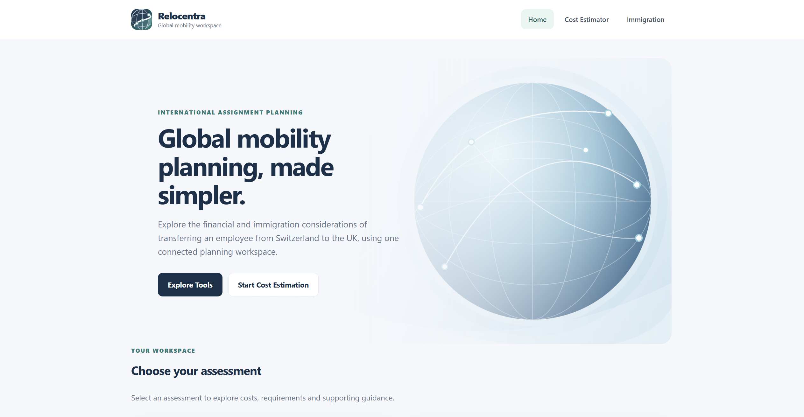
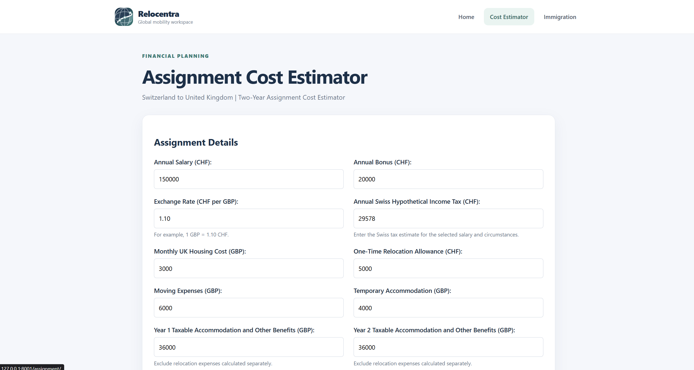
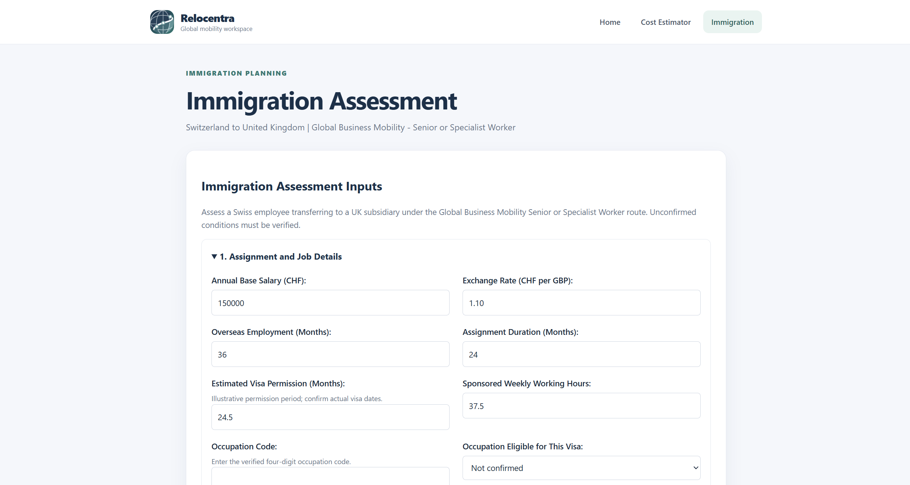

# Relocentra

A Django based application for estimating international employee assignment costs and assessing immigration requirements.

The application focuses on a two-year employee transfer from Zurich, Switzerland, to London, United Kingdom.

## Features

**1. Assignment Cost Estimator**

- Annual salary and bonus conversion from CHF to GBP.
- UK income tax calculations with iterative tax gross-up.
- Hypothetical Swiss tax and social security deductions.
- Employer social security contributions and alternative UK National Insurance estimates.
- Accommodation, relocation and moving expense assessments.
- Annual and total two-year employer cost breakdowns.
- References to official tax and social security guidance.

**2. Immigration Assessment**

- Global Business Mobility – Senior or Specialist Worker visa eligibility checks.
- Employer sponsorship and Certificate of Sponsorship requirements.
- Business visitor and Electronic Travel Authorisation (ETA) assessments.
- Passport and supporting-document requirements.
- Visa, healthcare surcharge and sponsorship cost estimates.
- Processing timelines and optional priority services.
- Official UK government references.

## Application Screenshots

### Landing Page


### Financial Cost Estimator


### Immigration Assessment


## Technology Stack

- Python
- Django
- HTML and CSS
- Django Forms
- Python `decimal` module for financial calculations
- Django automated testing framework

## Prerequisites

- Python 3.11 or newer (developed and tested using Python 3.14.3).
- Git for cloning the repository.
- Internet access to install Python dependencies.

## Installation

**1. Clone the repository**

`git clone https://github.com/NIMIJITHNJ/relocentra.git`

`cd relocentra`

**2. Create a virtual environment**

`python -m venv .venv`

**3. Activate the environment**

Windows PowerShell:

`.\.venv\Scripts\Activate.ps1`

macOS/Linux:

`source .venv/bin/activate`

**4. Install dependencies**

`pip install -r requirements.txt`

### Configure Environment Variables

Relocentra requires a Django secret key and development mode
to run locally.

**Windows PowerShell**

Run these commands in the project terminal:

```powershell
$env:DJANGO_SECRET_KEY = (python -c "import secrets; print(secrets.token_urlsafe(50))")
$env:DJANGO_DEBUG = "True"
```

**macOS / Linux**

```bash
export DJANGO_SECRET_KEY="$(python -c 'import secrets; print(secrets.token_urlsafe(50))')"
export DJANGO_DEBUG=True
```

These commands generate a temporary secret key and enable
Django development mode.

Environment variables remain available in the current
terminal session. Repeat these commands when opening
a new terminal session.

Do not commit actual secret keys or credentials to GitHub.

These settings are intended for local development only.
Production deployment requires appropriate security
settings, including DEBUG=False and configured ALLOWED_HOSTS.

**5. Apply database migrations**

`python manage.py migrate`

**6. Start the development server**

`python manage.py runserver`


## Access the Application

After starting the Django development server, open:

- **Home:** http://127.0.0.1:8000/
- **Financial Cost Estimator:** http://127.0.0.1:8000/assignment/
- **Immigration Assessment:** http://127.0.0.1:8000/immigration/

The landing page provides direct access to both assessment tools.

All three pages share a consistent interface, including
navigation, branding and responsive layouts.

Both assessment tools include pre-filled values for the
Switzerland-to-UK assignment scenario.

No external API credentials are required to run the
existing calculations.

## Running Tests

Run all automated tests:

`python manage.py test`

Run the financial estimator tests:

`python manage.py test estimator`

Run the immigration tests:

`python manage.py test immigration`

At the latest development checkpoint, the project contained 219 passing automated tests.

## Assessment Scenario

The application is built around the following case:

- Home country: Switzerland (Zurich City).
- Host country: United Kingdom (London).
- Assignment: 6 April 2026 to 5 April 2028.
- Employee: Swiss national, single, no children.
- Previous overseas employment: 3 years.
- Annual salary: CHF 150,000.
- Annual bonus: CHF 20,000.
- Employer-paid housing: £3,000 per month.
- Relocation allowance: CHF 5,000.
- Moving expenses: £6,000.
- Temporary accommodation: £4,000.
- Exchange rate: £1 = CHF 1.10.

The financial assessment uses 2026/27 UK income tax rates for both assignment years, as specified in the candidate brief.

## Project Structure

- `config/` - Django project settings and main URL configuration.
- `core/` - Landing page, shared templates, branding and CSS.
- `estimator/` - Financial forms, calculations, templates, URLs and tests.
- `immigration/` - Immigration eligibility, fees, sponsorship, visitor checks, documents, timelines and tests.
- `requirements.txt` - Python dependencies.
- `manage.py` - Django management commands.

The financial and immigration calculations are organised into
separate service modules to keep business logic independent
of Django views.

## Assumptions and Limitations

The financial estimator uses an editable hypothetical Swiss income tax amount. This is not automatically recalculated when salary or personal circumstances change.

Tax exemptions, social security coverage and accommodation treatment depend on the selected assumptions and applicable rules.

The immigration assessment focuses on the Swiss-to-UK transfer described in the candidate brief. Actual visa eligibility depends on occupation, salary, sponsorship, personal circumstances and Home Office requirements.

The displayed fees and processing times are estimates based on the referenced rules. They may change.

Relocentra is an assessment tool, not professional tax or immigration advice.

## Official Sources

The application links to relevant official sources, including:

- HM Revenue & Customs: https://www.gov.uk/
- Swiss Federal Tax Administration: https://swisstaxcalculator.estv.admin.ch/
- Swiss social insurance information: https://www.ahv-iv.ch/
- UK Senior or Specialist Worker visa: https://www.gov.uk/senior-specialist-worker-visa

Specific sources are provided alongside relevant calculations and requirements in the application.

## AI Tool Usage

ChatGPT was used to research and understand UK and Swiss tax, social security and immigration requirements, identify official reference sources, plan the application structure, and assist with drafting implementation and testing material.

## Demonstration Video

A 5–10 minute Loom demonstration covering installation, application functionality, calculation logic and code structure is linked below.

**Loom link: https://drive.google.com/file/d/1yD7F04PLzv-Uu_mgAjXe-T-MB4WK3O70/view?usp=drive_link**.
